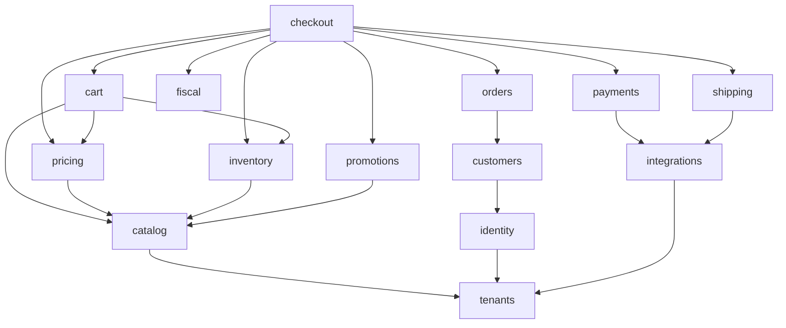
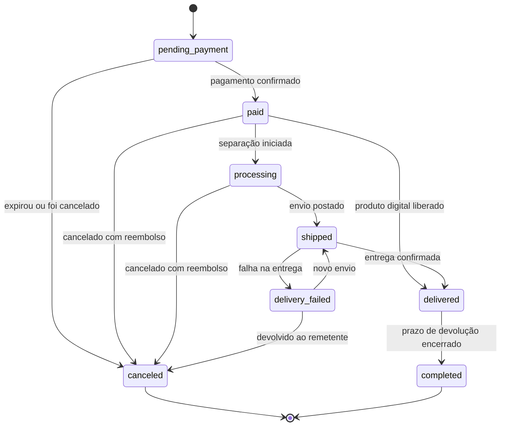
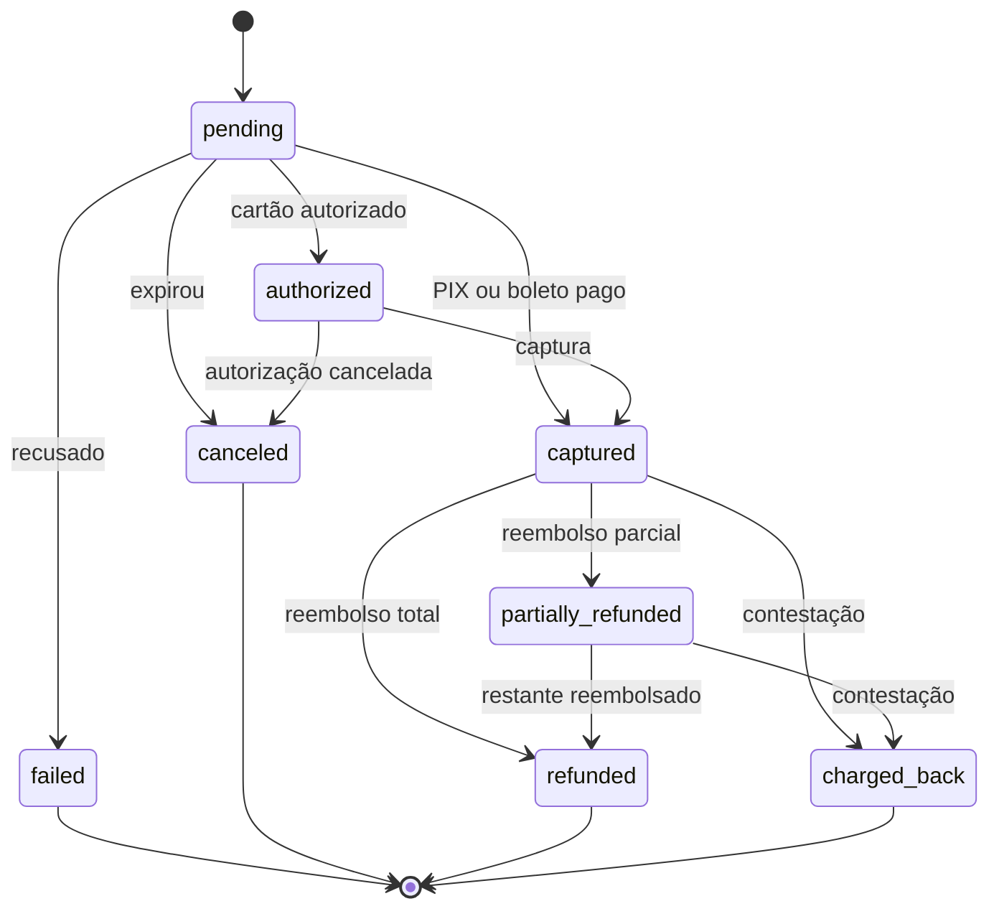
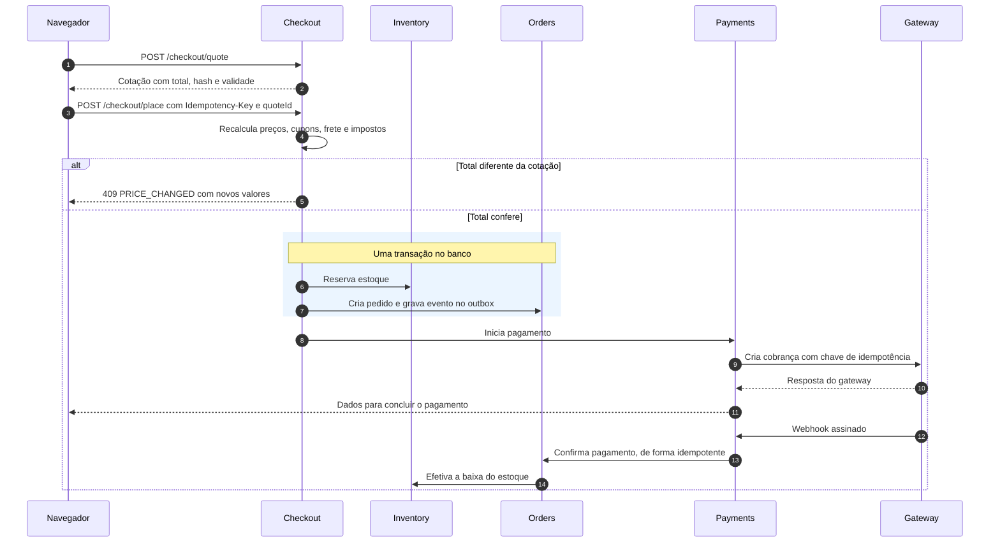

# Modelo de domínio e organização dos módulos

## 1. Bounded contexts

| Módulo | Responsabilidade | Entidades principais | Fase |
| --- | --- | --- | --- |
| `tenants` | Lojas, domínios, branding, planos, feature flags | Tenant, Domain, Theme, Plan, FeatureFlag | 3 |
| `identity` | Usuários, sessões, MFA, papéis e permissões | User, PlatformUser, Session, Role, Permission | 4 |
| `audit` | Trilha imutável de operações administrativas | AuditEntry | 4 |
| `catalog` | Produtos, variações, categorias, marcas, atributos | Product, Variant, Category, Brand, Attribute | 5 |
| `inventory` | Saldos, depósitos, reservas, movimentações | Warehouse, StockLevel, Reservation, Movement | 5 |
| `pricing` | Preços, tabelas, regras, histórico | PriceList, Price, TierPrice | 5 |
| `customers` | Perfis, endereços, grupos, favoritos | Customer, Address, CustomerGroup, Wishlist | 5 |
| `cart` | Carrinhos anônimos e autenticados | Cart, CartItem | 5 |
| `checkout` | Orquestra a finalização da compra | CheckoutSession, Quote | 5 |
| `orders` | Ciclo de vida do pedido, devoluções | Order, OrderItem, StatusHistory, ReturnRequest | 5 |
| `payments` | Abstração de gateways, transações, webhooks | Payment, Transaction, Refund, WebhookEvent | 6 |
| `shipping` | Cotação, envios, etiquetas, rastreio | ShippingMethod, Shipment, TrackingEvent | 6 |
| `notifications` | E-mails e modelos por tenant | Template, Notification | 6 |
| `search` | Busca, facetas, autocomplete | SearchDocument, SearchQuery | 6 |
| `integrations` | Credenciais e conexões externas por tenant | IntegrationAccount | 6 |
| `promotions` | Cupons, regras, campanhas, fidelidade | Coupon, Promotion, Campaign, LoyaltyAccount | 7 |
| `content` | Páginas, banners, blog, SEO | Page, Banner, Post, Redirect | 7 |
| `reviews` | Avaliações, perguntas e respostas | Review, Question | 7 |
| `analytics` | Indicadores e relatórios | DailySales, ReportJob | 7 |
| `fiscal` | Regras tributárias configuráveis, histórico fiscal | TaxProfile, TaxRule, FiscalRecord | 7 |
| `privacy` | Consentimentos e solicitações LGPD | Consent, DataSubjectRequest | 7 |
| `subscriptions` | Produtos recorrentes de compradores | SubscriptionPlan, Subscription | Pós-MVP |

Módulos adicionados em relação à especificação:

- **`audit`, `fiscal` e `privacy`** têm regras próprias que não pertencem a outro domínio.
- **Planos do SaaS ficam em `tenants`**. Assim, `subscriptions` trata apenas da recorrência vendida pelas lojas aos compradores, evitando misturar dois conceitos com o mesmo nome.
- **Marketplace e B2B** ficam reservados para depois do MVP. O modelo já comporta `seller_id` e split via gateway, sem custo para quem não usa.

## 2. Regras de dependência

1. Um módulo só importa o pacote `contract/` de outro. O compilador bloqueia o restante.
2. Dependências síncronas formam um grafo acíclico. Quando dois módulos precisam reagir um ao outro, um deles usa eventos.
3. O domínio não importa HTTP, SQL, Redis nem bibliotecas de gateways.
4. Só `internal/app` conecta implementações concretas.
5. Handlers HTTP validam formato e chamam um caso de uso. Regras de negócio ficam no domínio.
6. Interfaces só existem em fronteiras reais: outro módulo, infraestrutura ou provedor externo.

CQRS é usado apenas onde há ganho claro: leitura do catálogo, busca e relatórios têm modelos próprios. Os demais módulos usam um único modelo.

## 3. Máquina de estados do pedido

- Toda transição passa por uma única função do domínio, que recusa mudanças inválidas.
- Cada transição grava histórico e evento na mesma transação.
- A atualização usa controle otimista por `version`.
- Reembolsos, devoluções e trocas são agregados próprios ligados ao pedido, porque podem ser parciais e ocorrer várias vezes.

## 4. Máquina de estados do pagamento

Webhooks podem chegar fora de ordem. Um evento que não representa uma transição válida é registrado e encaminhado para conciliação, sem alterar o estado.

## 5. Fluxo de checkout

Garantias:

| Risco | Proteção |
| --- | --- |
| Pedido duplicado | `Idempotency-Key` única por tenant, com hash do corpo da requisição |
| Valor alterado no navegador | O cliente só envia IDs e quantidades; valores vêm do servidor |
| Preço alterado durante a compra | Comparação com a cotação e resposta `409 PRICE_CHANGED` |
| Venda além do estoque | `UPDATE` condicional e `CHECK (reserved <= on_hand)` |
| Deadlock na reserva | Itens sempre reservados na mesma ordem de variante |
| Falha após reservar | Reserva tem validade e é liberada por job |
| Falha ao chamar o gateway | Pedido permanece pendente e o pagamento pode ser retomado |
| Webhook repetido | Unicidade por tenant, provedor e ID do evento |

## 6. Regras fiscais

O módulo `fiscal` oferece perfis e regras configuráveis, além de uma porta para provedores especializados. **Nenhuma alíquota fica fixa no código.** Sem configuração validada por um especialista, a loja não exibe imposto calculado como se fosse definitivo.
