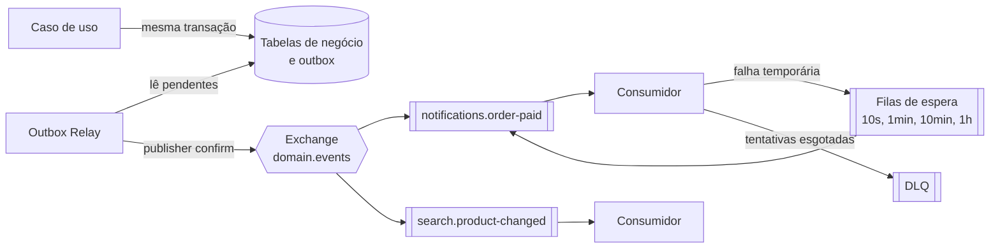

# Arquitetura orientada a eventos

## 1. Fluxo



## 2. Garantias

| Requisito | Implementação |
| --- | --- |
| Consistência entre banco e broker | Outbox gravado na mesma transação do dado |
| Publicação segura | Relay marca como publicado só depois do publisher confirm |
| Vários relays em paralelo | `SELECT ... FOR UPDATE SKIP LOCKED` em lotes |
| Duplicidade | Entrega ao menos uma vez; tabela `messaging.inbox` com chave `(consumer, event_id)` |
| Idempotência do consumidor | Inbox e efeito de negócio gravados na mesma transação |
| Ordem | Não é global; `aggregate_version` permite ignorar eventos antigos |
| Retentativas | Backoff em filas com TTL, no máximo 5 tentativas por padrão |
| Falha definitiva | DLQ com alerta e reprocessamento manual auditado |
| Rastreamento | `traceparent` propagado no envelope |
| Isolamento | O consumidor abre a transação usando o `tenant_id` do envelope |

Efeitos externos, como envio de e-mail, não participam da transação. Nesses casos, o provedor recebe uma chave de idempotência sempre que oferecer esse recurso. Quando não oferecer, existe um risco pequeno de envio duplicado, aceito para notificações e inaceitável para cobranças.

## 3. Envelope

Os eventos seguem o formato CloudEvents 1.0.

```json
{
  "specversion": "1.0",
  "id": "0196f2c1-7a10-7c3e-9f61-2d1f6f0b9a11",
  "source": "/modules/orders",
  "type": "orders.order.paid.v1",
  "time": "2026-11-18T14:03:22Z",
  "tenantid": "0196f2c1-1111-7000-8000-000000000001",
  "traceparent": "00-4bf92f3577b34da6a3ce929d0e0e4736-00f067aa0ba902b7-01",
  "aggregateid": "0196f2c1-2222-7000-8000-000000000002",
  "aggregateversion": 3,
  "datacontenttype": "application/json",
  "data": { "orderId": "0196f2c1-2222-7000-8000-000000000002" }
}
```

**Versionamento.** Adicionar um campo opcional mantém a versão. Remover ou mudar o significado de um campo cria `v2`, e as duas versões são publicadas durante a migração dos consumidores.

**Dados pessoais.** Eventos carregam IDs, não dados pessoais. O consumidor busca o que precisa no momento do processamento.

## 4. Eventos iniciais

| Evento | Produtor | Consumidores |
| --- | --- | --- |
| `tenants.tenant.suspended.v1` | tenants | identity, analytics |
| `tenants.domain.changed.v1` | tenants | Invalidação de cache |
| `identity.user.registered.v1` | identity | notifications, customers |
| `identity.password_reset.requested.v1` | identity | notifications |
| `catalog.product.changed.v1` | catalog | search |
| `pricing.price.changed.v1` | pricing | search |
| `inventory.stock.low.v1` | inventory | notifications |
| `cart.abandoned.v1` | cart | notifications |
| `orders.order.created.v1` | orders | analytics, notifications |
| `orders.order.paid.v1` | orders | inventory, notifications, analytics, fiscal |
| `orders.order.canceled.v1` | orders | inventory, payments, notifications |
| `orders.order.shipped.v1` | orders | notifications |
| `payments.payment.captured.v1` | payments | orders |
| `payments.payment.failed.v1` | payments | orders, notifications |
| `payments.refund.completed.v1` | payments | orders, notifications |
| `shipping.shipment.updated.v1` | shipping | orders, notifications |

## 5. Jobs agendados

| Job | Função |
| --- | --- |
| Liberação de reservas | Libera reservas vencidas |
| Expiração de pedidos | Cancela pedidos sem pagamento dentro do prazo |
| Conciliação de pagamentos | Compara transações locais com o gateway |
| Carrinhos abandonados | Publica eventos para recuperação, respeitando consentimento |
| Limpeza de outbox e inbox | Remove registros processados após a retenção |
| Publicação agendada | Publica conteúdo com data programada |

Jobs são executados pelo Worker e usam advisory locks do PostgreSQL para evitar execução simultânea.

## 6. Implementado na Fase 6

O fluxo da seção 1 está em funcionamento (ADR-018), com o relay dentro do processo `worker`.

| Evento | Produzido quando | Consumidores |
| --- | --- | --- |
| `orders.order.created.v1` | O checkout cria o pedido | `sales-notifications` |
| `orders.order.paid.v1` | Uma notificação autenticada confirma o pagamento | `sales-notifications` |
| `orders.order.shipped.v1` | A equipe marca o pedido como enviado | `sales-notifications` |
| `orders.order.canceled.v1` | O pedido é cancelado pela equipe, pelo prazo ou pelo pagamento recusado | `sales-notifications` |
| `payments.refund.requested.v1` | Um pedido pago é cancelado ou o pagamento chega depois do cancelamento | `sales-refunds` |
| `payments.refund.completed.v1` | O provedor confirma o estorno | `sales-notifications` |

Os demais eventos da seção 4 só passam a ser gravados quando tiverem um consumidor.

Para cada consumidor existem as filas `<nome>` (quorum), `<nome>.retry.1` a `<nome>.retry.4` e `<nome>.dlq`. Para inspecionar e reprocessar a DLQ:

```bash
docker compose exec worker /app/worker dlq list --consumer sales-notifications
docker compose exec worker /app/worker dlq replay --consumer sales-notifications --limit 10 --reason "Falha corrigida"
```

A listagem mostra tipo, loja, tentativas e erro, nunca o conteúdo do evento. O reprocessamento fica registrado na auditoria da plataforma.

O job "Liberação de reservas" é feito pela expiração de pedidos, que libera o estoque reservado. "Conciliação de pagamentos" depende de um gateway real, e "Carrinhos abandonados" e "Publicação agendada" chegam com a Fase 7.
