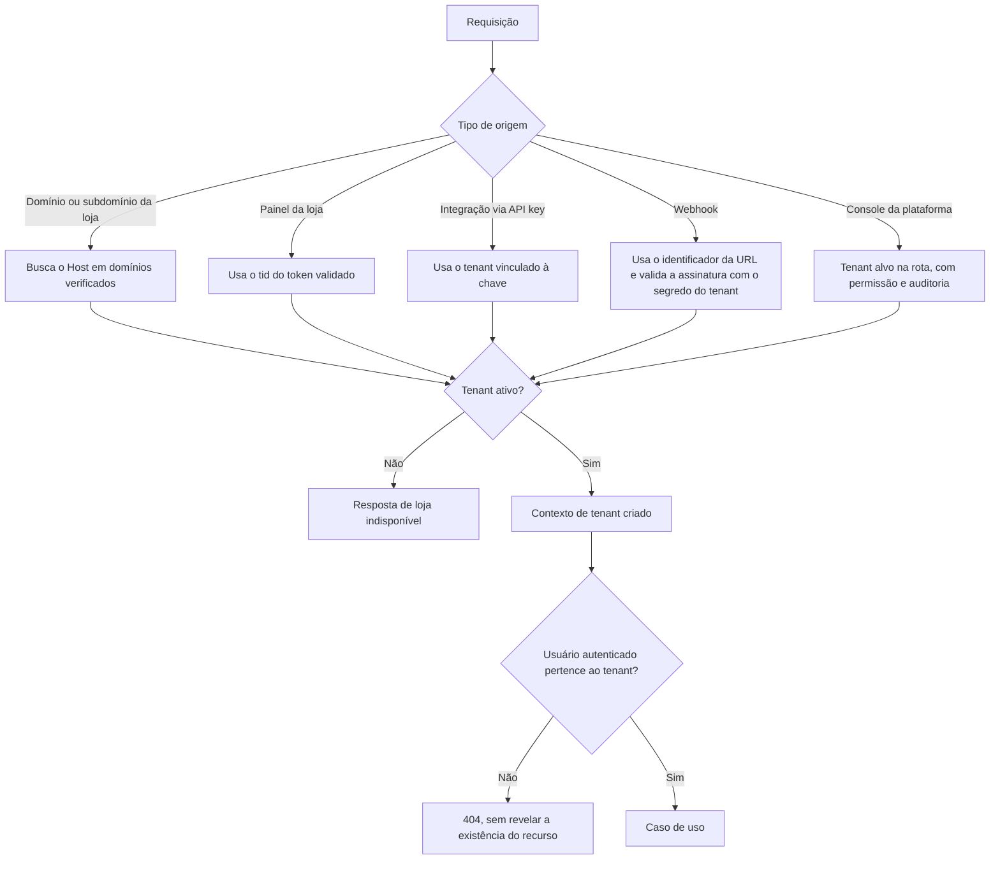

# Estratégia Multi-Tenant

## 1. Modelo

Banco compartilhado, com isolamento lógico em **cinco camadas independentes**. Uma falha em uma camada não deve expor dados de outra loja.

| Camada | Controle |
| --- | --- |
| Borda | Host aceito somente se for um domínio verificado |
| HTTP | Middleware cria o contexto de tenant; o `tid` do token precisa ser igual ao tenant da requisição |
| Aplicação | Repositórios só recebem uma transação com tenant definido e filtram por `tenant_id` |
| Banco | RLS com `FORCE`, papéis sem `BYPASSRLS` e chaves estrangeiras compostas |
| Recursos auxiliares | Prefixo de tenant em cache, objetos e índices de busca; `tenant_id` em toda mensagem |

## 2. Resolução do tenant



Regras:

- **Nenhum `tenant_id` enviado no corpo, na query ou em cabeçalho é aceito** nas rotas da loja.
- A API usa somente o cabeçalho `Host` definido pela borda. `X-Forwarded-Host` e cabeçalhos semelhantes são ignorados.
- O resultado da resolução fica em cache local por 30 segundos, e hosts desconhecidos por 10 segundos. Por isso, suspender uma loja ou remover um domínio leva até 30 segundos para valer em todas as instâncias.
- Um domínio próprio só é ativado após comprovação por registro DNS TXT. Ao remover um domínio, a associação é apagada imediatamente.

## 3. Isolamento no PostgreSQL

Toda tabela de loja segue este padrão:

```sql
CREATE FUNCTION app.current_tenant_id() RETURNS uuid
LANGUAGE sql STABLE PARALLEL SAFE AS
$$ SELECT NULLIF(current_setting('app.tenant_id', true), '')::uuid $$;

CREATE TABLE catalog.products (
  tenant_id uuid NOT NULL REFERENCES core.tenants (id),
  id        uuid NOT NULL,
  sku       text NOT NULL,
  PRIMARY KEY (tenant_id, id),
  UNIQUE (tenant_id, sku)
);

CREATE TABLE catalog.product_variants (
  tenant_id  uuid NOT NULL,
  id         uuid NOT NULL,
  product_id uuid NOT NULL,
  PRIMARY KEY (tenant_id, id),
  FOREIGN KEY (tenant_id, product_id)
    REFERENCES catalog.products (tenant_id, id)
);

ALTER TABLE catalog.products ENABLE ROW LEVEL SECURITY;
ALTER TABLE catalog.products FORCE ROW LEVEL SECURITY;

CREATE POLICY tenant_isolation ON catalog.products
  USING (tenant_id = (SELECT app.current_tenant_id()))
  WITH CHECK (tenant_id = (SELECT app.current_tenant_id()));
```

Pontos que evitam falhas conhecidas:

- **`NULLIF(..., '')`**: depois de uma transação, a variável volta como texto vazio, e converter isso para `uuid` causaria erro.
- **`(SELECT ...)` na política**: o valor é calculado uma vez por consulta, e não por linha.
- **Chave estrangeira composta**: verificações de FK ignoram RLS, então uma FK simples permitiria apontar para uma linha de outra loja.
- **`set_config(..., true)`**: o valor vale só na transação, o que é seguro com PgBouncer em modo transação.

### Papéis do banco

| Papel | Uso | Acesso |
| --- | --- | --- |
| `app_owner` | Migrations, nunca em tempo de execução | Dono dos objetos, também sujeito a `FORCE` |
| `app_runtime` | API e Worker | DML nas tabelas, sempre filtrado por RLS |
| `app_platform` | Ferramenta `tenantctl` e, na Fase 7, o console da plataforma | Gestão das tabelas de lojas; sem DDL e sem acesso a dados de negócio |
| `app_relay` | Outbox Relay (Fase 6) | Somente tabela de outbox |

A busca de domínio ocorre antes de existir contexto de tenant. Por isso, `app_runtime` não lê a tabela de domínios e usa apenas a função `core.resolve_tenant_by_host`, que retorna ID e status.

### Acesso pela aplicação

Repositórios não recebem o pool de conexões. A única forma de obter uma transação é esta:

```go
func (db *DB) WithTenant(ctx context.Context, fn func(pgx.Tx) error) error {
    tenantID, ok := tenancy.FromContext(ctx)
    if !ok {
        return tenancy.ErrMissingTenant
    }
    return pgx.BeginFunc(ctx, db.pool, func(tx pgx.Tx) error {
        _, err := tx.Exec(ctx,
            `SELECT set_config('app.tenant_id', $1, true)`, tenantID.String())
        if err != nil {
            return err
        }
        return fn(tx)
    })
}
```

As consultas continuam com `WHERE tenant_id = $1`. Isso dá uma segunda linha de defesa e permite ao planejador usar os índices compostos.

## 4. Recursos fora do banco

| Recurso | Regra |
| --- | --- |
| Redis | Chaves só são criadas por um cliente que aplica `t:{tenant_id}:` |
| Object Storage | Caminho `tenants/{tenant_id}/...`; upload por URL pré-assinada com tipo e tamanho validados |
| RabbitMQ | `tenant_id` no envelope; o consumidor abre a transação com esse tenant |
| Busca | Filtro obrigatório aplicado pelo adaptador, nunca pelo chamador |
| Cache de páginas (CDN) | O Host faz parte da chave de cache |
| Logs e traces | `tenant_id` como campo; sem dados pessoais |
| Métricas | Sem `tenant_id` em métricas de alta cardinalidade ([metrics.md](../observability/metrics.md)) |

## 5. Configuração por tenant

| Grupo | Conteúdo | Quem altera |
| --- | --- | --- |
| Branding | Logo, favicon, cores, tipografia, tema | Admin da loja |
| Loja | Nome, moeda, idioma, fuso horário | Admin da loja |
| Domínios | Subdomínio e domínios próprios | Admin da loja, com verificação |
| Funcionalidades | Avaliações, favoritos, fidelidade, assinaturas, marketplace | Limitado pelo plano |
| Integrações | Pagamento, frete, analytics, marketing | Admin da loja, com segredos cifrados |
| SEO | Meta tags, sitemap, robots, redirecionamentos | Admin da loja |
| Plano e limites | Plano, cotas, suspensão | Somente Super Admin |

Uma funcionalidade está ativa quando `plano permite E tenant habilitou E não há bloqueio global`. O backend avalia essa regra em cada operação. O frontend usa o resultado apenas para exibir a interface.

Alterações de tema criam uma nova versão, com pré-visualização e retorno à versão anterior.

## 6. Provisionamento

Enquanto não existe login, nenhuma rota HTTP altera dados de lojas. O cadastro é feito pela ferramenta `tenantctl`, executada por operadores com acesso ao ambiente (ADR-015). Os comandos estão em [Primeiros passos](../development/getting-started.md).

## 7. Vizinho barulhento

- Rate limit por tenant, por IP e por usuário.
- Cotas por plano: produtos, usuários, armazenamento e chamadas de API.
- `statement_timeout` por papel, para impedir consultas longas.
- Limite de exportações e importações simultâneas por tenant.
- Consumo justo nas filas de trabalhos pesados, com limite de mensagens em processamento por tenant.

## 8. Testes obrigatórios de isolamento

A suíte `backend/tests/integration` roda no CI com PostgreSQL real. Ela descobre automaticamente as tabelas com `tenant_id`, então tabelas futuras entram na verificação sem alteração nos testes. A prova de conceito abaixo validou o desenho na Fase 1.

| Cenário da prova de conceito | Resultado |
| --- | --- |
| 20 cenários de isolamento: sem contexto, escrita cruzada, FK composta, `FORCE RLS`, papéis e resolução de domínio | Todos aprovados |
| 200 compras simultâneas da última unidade | 1 reserva concluída |
| 500 compras simultâneas de 10 unidades | 10 reservas concluídas |
| 300 carrinhos de 8 itens, reservados em ordem fixa | 0 deadlocks (em ordem aleatória, a mesma carga gerou 299) |
| 100 requisições com a mesma chave de idempotência | 1 processamento |
| 5.000 transações alternando dois tenants em um pool de 40 conexões | 0 vazamentos |

| Teste | Resultado esperado |
| --- | --- |
| Toda tabela com `tenant_id` tem RLS habilitado e forçado | Falha o CI se alguma tabela não tiver |
| Nenhum papel de execução é superusuário ou tem `BYPASSRLS` | Falha o CI se tiver |
| Token da loja A usado no domínio da loja B | Acesso negado |
| ID de recurso da loja B acessado pela loja A, em cada endpoint | 404 |
| Consulta sem contexto de tenant | Zero linhas |
| Chave de cache e mensagem de outro tenant | Sem acesso aos dados |
| Staff de uma loja chamando rota do console | 403 |
