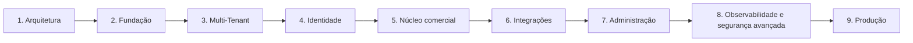

# Roadmap técnico

Cada fase termina com o projeto executável, testes passando e documentação atualizada. Uma fase só avança depois de cumprir seus critérios de saída e resolver as decisões pendentes.

| Fase | Entregas | Critérios de saída |
| --- | --- | --- |
| **1. Arquitetura** | Documentos desta pasta, ADRs, modelo de dados, modelo de ameaças | Concluída |
| **2. Fundação** | Backend e frontend executáveis, Compose com todos os serviços, migrations, configuração por ambiente, logs, OpenTelemetry, health checks, erros globais, CI básico | Concluída. Uso real do RabbitMQ fica para a Fase 6 |
| **3. Multi-Tenant** | Tenants, domínios, RLS, configurações, temas, feature flags, frontend com tema dinâmico | Concluída. A gestão de lojas pelo painel fica para a Fase 7 |
| **4. Identidade** | Cadastro, login, recuperação, MFA, sessões, RBAC, auditoria, rate limit | Concluída. E-mails são enviados em segundo plano pela própria API até a mensageria da Fase 6 |
| **5. Núcleo comercial** | Produtos, categorias, estoque, preços, clientes, carrinho, checkout, pedidos e loja navegável | Concluída (ADR-017). Gateways, transportadoras, impostos, listas de preço e busca avançada ficam para as Fases 6 e 7 |
| **6. Integrações** | RabbitMQ e Outbox em produção interna, um gateway real em sandbox, webhooks, frete, e-mail, busca | Concluída, exceto o sandbox real (ADR-018): webhook duplicado sem efeito duplo e DLQ testados com RabbitMQ real. A validação no sandbox depende da escolha do gateway |
| **7. Administração** | Console da plataforma, admin da loja, promoções, CMS, SEO, relatórios, LGPD | Operação de uma loja sem acesso ao banco; testes E2E e de acessibilidade |
| **8. Observabilidade e segurança avançada** | Dashboards, alertas, runbooks, ZAP, k6, teste de restauração | Capacidade medida e documentada; achados altos de segurança resolvidos |
| **9. Produção** | CI/CD completo, Kubernetes, backups, disaster recovery, resposta a incidentes, revisão de segurança | Deploy e rollback ensaiados; restauração medida; pentest externo concluído |

## Documentos que ainda serão criados

| Documento | Fase |
| --- | --- |
| `docs/security/incident-response.md` | 9 |
| `docs/deployment/deployment-guide.md` | 9 |

## Definição de pronto

Uma funcionalidade só está concluída quando:

1. Considera o isolamento entre tenants e possui teste que prova esse isolamento.
2. Exige autenticação e autorização quando necessário, com testes.
3. Tem testes relevantes, sem dados simulados apresentados como funcionalidade real.
4. Emite logs, métricas e traces adequados.
5. Passa por lint e por scans de segurança no CI.
6. Tem documentação atualizada.

Uma integração só é declarada funcional depois de testada no ambiente real ou sandbox do provedor.

## Fora do MVP

Marketplace, B2B, assinaturas de produtos, emissão de NF-e, recomendações avançadas e múltiplas moedas. A arquitetura não os impede, mas eles não entram nas fases iniciais.
