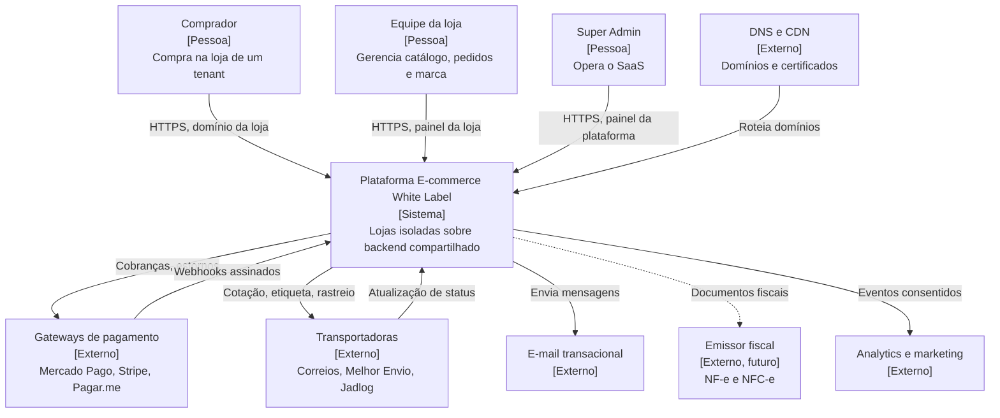
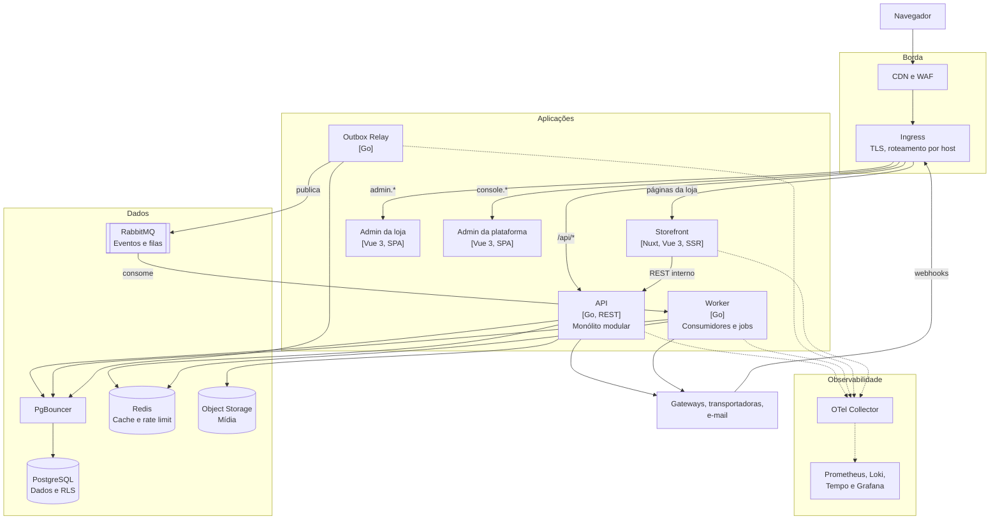
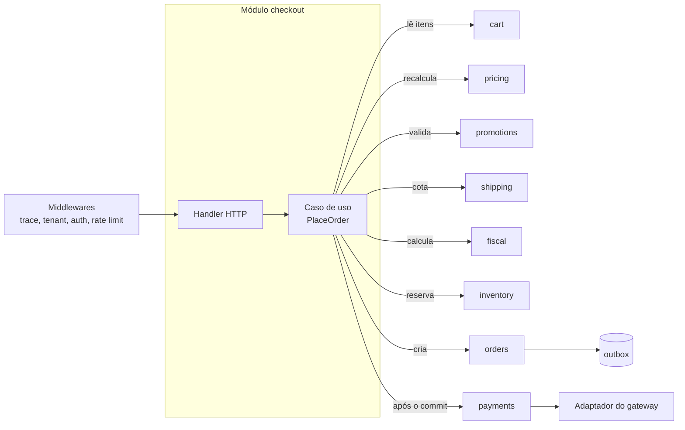
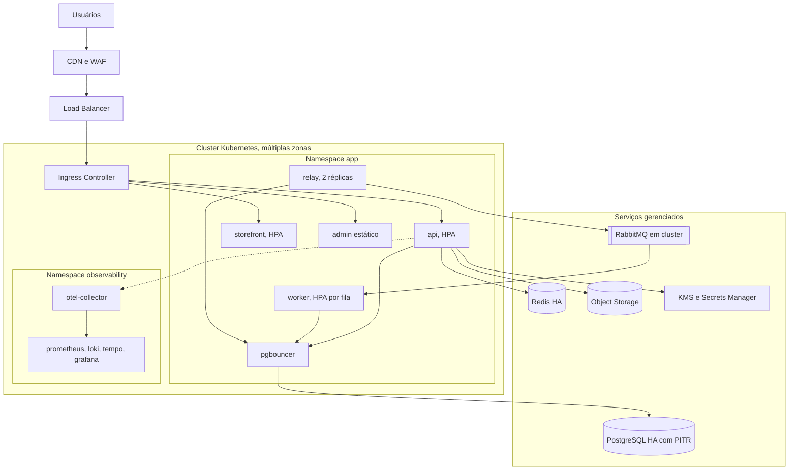

# Visão geral do sistema

Status: Fase 1, proposta para aprovação. As decisões citadas como ADR estão em [architecture-decisions.md](architecture-decisions.md).

## 1. Objetivo e princípios

A plataforma é um SaaS de e-commerce White Label: **um único backend e um único código de frontend** atendem várias lojas isoladas. Toda diferença entre lojas vem de configuração, temas, feature flags e pontos de extensão controlados. Não existem forks por cliente.

| Princípio | Consequência prática |
| --- | --- |
| Isolamento é garantido em camadas | Aplicação, banco (RLS), cache, filas e armazenamento aplicam o tenant de forma independente |
| O servidor é a fonte da verdade | Preço, desconto, frete, estoque e tenant são sempre recalculados ou validados no backend |
| Fronteiras antes de distribuição | Monólito modular com fronteiras impostas pelo compilador; extração só com evidência |
| Falhar fechado | Sem contexto de tenant, o banco devolve zero linhas |
| Observável desde o primeiro endpoint | Logs, métricas e traces fazem parte da Fase 2, não da Fase 8 |
| Simplicidade justificada | Toda abstração precisa de um segundo uso real ou de uma fronteira de teste |

## 2. C4 nível 1: contexto



## 3. C4 nível 2: containers



API, Worker e Relay são **o mesmo código Go** com pontos de entrada diferentes (`cmd/api`, `cmd/worker`, `cmd/relay`). Eles escalam de forma independente, sem virar microsserviços.

## 4. C4 nível 3: componentes do fluxo de compra



## 5. C4 nível 4: implantação alvo



O provedor de nuvem ainda não foi escolhido. O desenho usa apenas capacidades disponíveis nos principais provedores.

## 6. Tecnologias e justificativas

As versões exatas serão fixadas na Fase 2.

| Área | Escolha | Por que | Alternativa descartada |
| --- | --- | --- | --- |
| Linguagem | Go | Requisito; binário único, concorrência simples | n/a |
| HTTP | `net/http` com chi | Compatível com a biblioteca padrão, sem framework invasivo | Gin, Fiber: API própria ou fora do `net/http` |
| Acesso a dados | pgx com sqlc | SQL explícito e tipado, essencial para RLS e consultas auditáveis | GORM: esconde SQL e dificulta revisar o isolamento |
| Migrations | goose | Migrations SQL versionadas, simples de rodar em pipeline | golang-migrate: equivalente, menos flexível em Go |
| Banco | PostgreSQL 18 | RLS maduro, transações, JSONB, busca textual | n/a |
| Pool | PgBouncer em modo transação | Protege o limite de conexões; compatível com `set_config` local | Conexão direta: esgota com escala horizontal |
| Cache | Redis | Cache, rate limit e dados temporários; nunca fonte da verdade | n/a |
| Mensageria | RabbitMQ | Filas de trabalho, DLQ e retentativas por mensagem (ADR-008) | Kafka: custo operacional sem necessidade de replay |
| Busca | PostgreSQL FTS, depois OpenSearch | Começa sem nova infraestrutura, atrás de uma porta (ADR-011) | OpenSearch desde o início: custo prematuro |
| Storefront | Nuxt (Vue 3, Pinia, Vue Router, Tailwind) | SEO exige HTML no servidor (ADR-006, pendente) | SPA pura: prejudica SEO e causa flash de tema |
| Painéis | Vue 3, Vite, Pinia, Vue Router, Tailwind | Área autenticada não precisa de SSR | n/a |
| Telemetria | OpenTelemetry, Prometheus, Loki, Tempo, Grafana | Requisito; padrão aberto e sem aprisionamento | n/a |
| Logs | `log/slog` em JSON | Biblioteca padrão, sem dependência extra | zap, zerolog: ganho não justificado agora |
| Testes | Go testing, Testcontainers, Vitest, Playwright, k6, ZAP | Requisito; banco real nos testes de isolamento | Mocks de banco: não exercitam RLS |

## 7. Estrutura inicial de diretórios

```text
.
├── backend/
│   ├── cmd/
│   │   ├── api/                  # Servidor HTTP
│   │   ├── worker/               # Consumidores e jobs
│   │   ├── relay/                # Publicação do outbox
│   │   └── migrate/              # Migrations
│   ├── internal/
│   │   ├── app/                  # Composition root: conecta os módulos
│   │   ├── platform/             # config, database, cache, messaging,
│   │   │                         # middleware, observability, security
│   │   ├── modules/
│   │   │   └── catalog/          # Mesmo formato em todos os módulos
│   │   │       ├── module.go     # Registro de rotas, consumidores e dependências
│   │   │       ├── contract/     # Única parte importável por outros módulos
│   │   │       └── internal/     # Invisível para os demais, garantido pelo compilador
│   │   │           ├── domain/   # Entidades e regras, sem infraestrutura
│   │   │           ├── app/      # Casos de uso e portas
│   │   │           └── adapters/ # http, postgres, events, gateways
│   │   └── shared/               # errors, events, pagination, money
│   ├── migrations/               # Uma pasta por módulo
│   ├── api/                      # OpenAPI usado na geração e nos contract tests
│   ├── tests/                    # integration, isolation, concurrency, contract
│   ├── Dockerfile
│   ├── Makefile
│   └── go.mod
├── frontend/
│   ├── apps/
│   │   ├── storefront/           # Loja (SSR)
│   │   ├── admin/                # Admin da loja
│   │   └── console/              # Admin da plataforma
│   └── packages/
│       ├── ui/                   # Design system e tokens CSS
│       ├── theme/                # Validação e aplicação de temas
│       ├── api-client/           # Cliente gerado a partir do OpenAPI
│       └── config/               # ESLint, TypeScript, Tailwind
├── deployments/
│   ├── compose/                  # Ambiente de desenvolvimento
│   ├── kubernetes/               # Base e overlays por ambiente
│   └── observability/            # Dashboards, alertas e Collector
├── tests/                        # e2e, load (k6), security (ZAP)
├── docs/
└── .github/workflows/
```

Diferenças em relação à estrutura sugerida na especificação:

- **`contract/` e `internal/` em cada módulo** fazem o compilador Go bloquear acesso indevido entre módulos.
- **`cmd/worker` e `cmd/relay`** permitem escalar o processamento assíncrono separadamente da API.
- **`shared/utils` foi removido**, porque pacotes genéricos tendem a acumular regras de negócio.
- **`deployments/` fica na raiz**, porque o Compose e o Kubernetes cobrem backend e frontend.
- **`frontend/` virou um monorepo** com três aplicações e pacotes compartilhados. Depende da aprovação do ADR-006.
