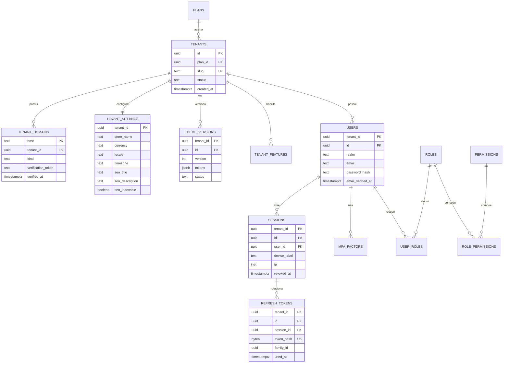
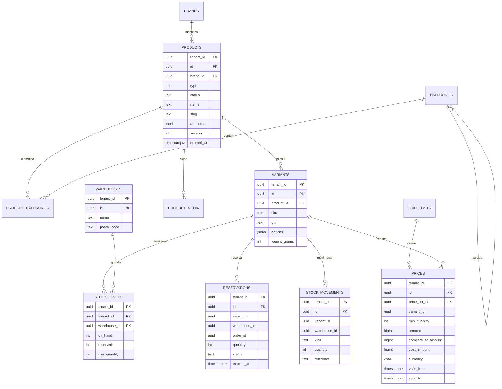
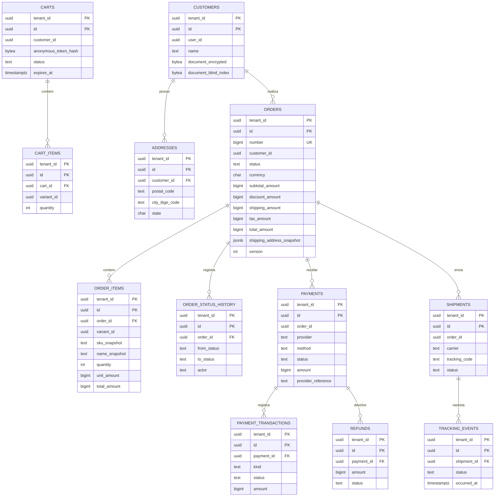

# Modelo de dados

Modelo inicial do núcleo. As colunas completas serão definidas nas migrations de cada fase.

## 1. Convenções

| Tema | Regra |
| --- | --- |
| Chave primária | `(tenant_id, id)` em tabelas de loja; `id` em UUIDv7 |
| Referência no mesmo módulo | Chave estrangeira composta com `tenant_id` |
| Referência entre módulos | Somente ID, com snapshot dos dados históricos |
| Dinheiro | `bigint` em centavos e `currency char(3)` |
| Datas | `timestamptz` em UTC |
| Texto sem diferenciar maiúsculas | Índice único sobre `lower(email)` |
| Exclusão lógica | `deleted_at` em produtos, categorias, clientes e conteúdo |
| Concorrência | Coluna `version` em agregados editáveis |
| JSONB | Só para dados realmente variáveis, como atributos e configurações |
| Índices | Sempre iniciados por `tenant_id`; paginação por cursor `(tenant_id, created_at, id)` |
| Isolamento | RLS habilitado e forçado em toda tabela com `tenant_id` |

Tabelas **globais**, sem `tenant_id`: `core.plans`, `core.feature_flags`, `core.plan_features`, `identity.permissions`, `identity.roles`, `identity.role_permissions`. A tabela `core.tenants` também usa RLS: cada loja lê somente a própria linha.

## 2. Plataforma e identidade



`users.realm` separa compradores (`customer`), equipes de loja (`staff`) e operadores (`platform`), com e-mail único por `(tenant_id, realm)`. Operadores pertencem a um tenant reservado, sem domínio (ADR-016).

## 3. Catálogo, estoque e preços



A reserva é uma operação atômica, sem trava em nível de aplicação:

```sql
UPDATE inventory.stock_levels
   SET reserved = reserved + $4
 WHERE tenant_id = $1 AND variant_id = $2 AND warehouse_id = $3
   AND on_hand - reserved >= $4;
-- 0 linhas afetadas significa estoque insuficiente
```

`STOCK_MOVEMENTS` é somente inclusão e serve como trilha de rastreabilidade.

## 4. Vendas



O número do pedido é sequencial por loja, gerado por um contador `(tenant_id, next_number)` dentro da transação do checkout.

### Implementado na Fase 5

Os diagramas acima são o modelo-alvo. A migration `00004_commerce.sql` implementa o subconjunto abaixo (ADR-017), todas as tabelas com `tenant_id` na chave, chaves estrangeiras compostas e RLS forçado.

| Schema | Tabelas | Observações |
| --- | --- | --- |
| `catalog` | `categories`, `products`, `product_images`, `variants`, `price_history` | Preço, preço comparativo e custo ficam na variante. Variantes vendidas são arquivadas, nunca apagadas |
| `inventory` | `warehouses`, `stock_levels`, `reservations`, `movements` | Um depósito padrão por loja. `CHECK (reserved <= on_hand)` e movimentações somente inclusão |
| `shipping` | `methods` | Retirada ou valor fixo por loja, com prazo mínimo e máximo em dias |
| `cart` | `carts`, `items` | Carrinho de visitante identificado pelo hash de um token em cookie |
| `orders` | `counters`, `orders`, `items`, `status_history`, `notes` | Snapshots de nome, SKU, preço e endereço. Notas internas visíveis só para a equipe |
| `payments` | `payments`, `transactions` | Provedor, status e valor. Sem dados de cartão |
| `checkout` | `idempotency_keys` | Resposta gravada na mesma transação do pedido |
| `customers` | `addresses` | Catálogo de endereços do comprador |

Ainda não existem: marcas, listas de preço, mídia além de URLs de imagem, CPF cifrado, remessas com eventos de rastreio (o código de rastreio fica no pedido) e reembolsos parciais.

### Implementado na Fase 6

| Tabela | Função |
| --- | --- |
| `messaging.outbox`, `messaging.inbox` | Eventos a publicar e eventos já tratados por consumidor. A aplicação só insere; o relay usa funções `SECURITY DEFINER` |
| `notifications.emails` | E-mails cifrados até a entrega, com tentativas e próximo envio |
| `payments.webhook_events` | Notificações de pagamento, únicas por `(tenant_id, provider, provider_event_id)`, com o resultado aplicado. O corpo bruto não é guardado |
| `shipping.rates` | Faixas de CEP e peso das formas de entrega do tipo `table` |

Também mudaram: `payments.payments.status` aceita `refund_pending`, `orders.orders.store_host` guarda o domínio onde o pedido foi feito, e `catalog.product_document()` alimenta o índice de busca.

## 5. Tabelas transversais

| Tabela | Função | Restrição principal |
| --- | --- | --- |
| `messaging.outbox` | Eventos pendentes de publicação | Índice parcial em `published_at IS NULL` |
| `messaging.inbox` | Eventos já consumidos | PK `(consumer, event_id)` |
| `core.idempotency_keys` | Respostas de operações críticas | Única em `(tenant_id, scope, key)` |
| `payments.webhook_events` | Webhooks brutos recebidos | Única em `(tenant_id, provider, provider_event_id)` |
| `audit.entries` | Trilha administrativa, somente inclusão | Nenhum papel da aplicação pode alterar ou apagar registros |
| `privacy.consents` | Consentimentos LGPD com finalidade e versão | Somente inclusão |

## 6. Índices iniciais

| Consulta | Índice |
| --- | --- |
| Listagem da loja por categoria | `product_categories (tenant_id, category_id, product_id)` |
| Página de produto | Único em `products (tenant_id, slug) WHERE deleted_at IS NULL` |
| SKU | Único em `variants (tenant_id, sku)` |
| Pedidos no painel | `orders (tenant_id, status, created_at DESC, id)` |
| Pedidos do cliente | `orders (tenant_id, customer_id, created_at DESC)` |
| Reservas vencidas | `reservations (expires_at) WHERE status = 'active'` |
| Busca por CPF ou CNPJ | `customers (tenant_id, document_blind_index)` |

Novos índices serão adicionados com base em `EXPLAIN ANALYZE` e `pg_stat_statements`.

## 7. Backup, retenção e crescimento

| Tema | Estratégia |
| --- | --- |
| Backup | Snapshot diário cifrado e arquivamento contínuo de WAL |
| Recuperação | PITR com metas iniciais de RPO de 5 minutos e RTO de 1 hora |
| Prova de restauração | Teste periódico automatizado; meta só vale depois de medida |
| Restauração de um tenant | Restaurar em ambiente isolado e copiar as linhas do tenant, com procedimento documentado |
| Particionamento | Adotado somente com evidência de volume, começando por `audit.entries` |
| Migrations | Compatíveis com a versão anterior (expandir, migrar, contrair) |
| Leitura | Réplicas para relatórios quando houver carga comprovada |
