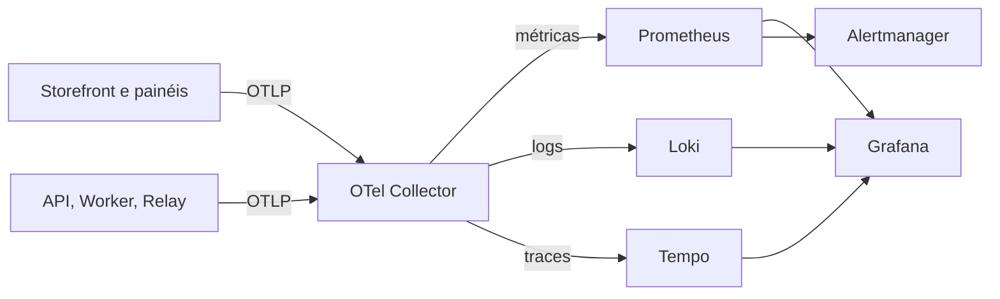

# Métricas

As aplicações usam o SDK do OpenTelemetry e enviam dados por OTLP ao Collector, que os entrega ao Prometheus.

## Catálogo inicial

| Métrica | Tipo | Rótulos |
| --- | --- | --- |
| `http.server.request.duration` | Histograma | `http.route`, `http.request.method`, `http.response.status_code`, `tenant_tier` |
| `http.server.active_requests` | Gauge | `http.route` |
| `db.client.connection.count` | Gauge | `state`, `pool` |
| `db.client.operation.duration` | Histograma | `db.operation.name`, `module` |
| `cache.requests` | Contador | `cache`, `result` |
| `messaging.outbox.pending` | Gauge | n/a |
| `messaging.outbox.oldest_age` | Gauge | n/a |
| `messaging.consumer.duration` | Histograma | `consumer`, `event_type`, `result` |
| `messaging.dlq.messages` | Gauge | `queue` |
| `checkout.attempts` | Contador | `result`, `reason`, `tenant_tier` |
| `orders.created` | Contador | `tenant_tier` |
| `orders.processing.duration` | Histograma | `stage` |
| `payments.attempts` | Contador | `provider`, `method`, `result` |
| `payments.webhooks` | Contador | `provider`, `result` |
| `integrations.request.duration` | Histograma | `integration`, `operation`, `result` |
| `security.auth.failures` | Contador | `realm`, `reason` |
| `security.rate_limited` | Contador | `scope` |
| `security.tenant_mismatch` | Contador | `source` |

Métricas do runtime Go (goroutines, memória, GC) e de infraestrutura (CPU, memória, PostgreSQL, Redis, RabbitMQ) vêm de instrumentação e exporters padrão.

## Controle de cardinalidade

- **`tenant_id` não é rótulo padrão.** Métricas usam `tenant_tier` (plano), que tem poucos valores.
- Visão detalhada por tenant é obtida por logs e traces, que aceitam alta cardinalidade.
- Uma lista limitada de tenants monitorados pode receber rótulo próprio, configurada no Collector.
- Indicadores comerciais por loja vêm do módulo `analytics`, e não do Prometheus.
- Rótulos nunca usam ID de usuário, pedido, URL bruta, e-mail ou mensagem de erro.
- O Collector aplica limites e descarta rótulos não permitidos.

## SLOs iniciais

Valores são hipóteses até haver medição em teste de carga.

| Indicador | Objetivo em 30 dias |
| --- | --- |
| Disponibilidade da API | 99,9% de respostas sem 5xx |
| Latência de leitura do catálogo | 95% abaixo de 300 ms |
| Latência de finalização do checkout | 95% abaixo de 1,5 s, sem contar o gateway |
| Processamento de webhook | 99% em até 30 s após o recebimento |
| Publicação de eventos | 99% em até 5 s após o commit |

## Dashboards

1. Saúde geral da plataforma.
2. Backend e APIs.
3. Banco de dados.
4. Mensageria.
5. Pagamentos.
6. Operações comerciais.
7. Segurança.

Os dashboards serão versionados como código em `deployments/observability`.
