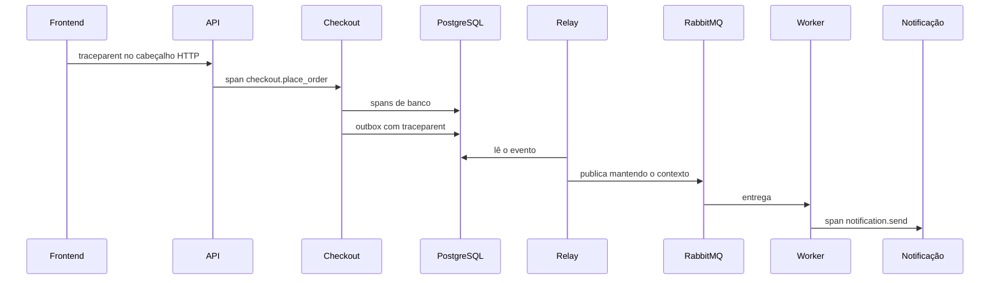

# Distributed Tracing

Instrumentação com OpenTelemetry, propagação W3C Trace Context e armazenamento no Grafana Tempo.

## Fluxo rastreado

## Convenções

| Tema | Regra |
| --- | --- |
| Nome de span | `modulo.operacao`, como `inventory.reserve` |
| Atributos | Convenções semânticas do OpenTelemetry, além de `tenant.id` e `tenant.tier` |
| Consultas SQL | Texto parametrizado, nunca os valores |
| Mensageria | O consumidor usa um link de span quando processa em lote |
| Erros | Status de erro no span, com tipo do erro e sem dados sensíveis |
| Correlação | `trace_id` nos logs e exemplars nas métricas de latência |
| Resposta da API | Cabeçalho `X-Correlation-ID` para uso do suporte |

Spans obrigatórios nos fluxos críticos: autenticação, catálogo, carrinho, checkout, reserva de estoque, pagamento, webhook, pedido e notificação.

## Amostragem

Feita no Collector com tail sampling, depois que o trace termina:

| Caso | Taxa inicial |
| --- | --- |
| Traces com erro | 100% |
| Traces lentos, acima do limite da rota | 100% |
| Checkout e pagamentos | 100% |
| Demais requisições | 10% |

Em produção, o tail sampling exige que todos os spans de um trace cheguem à mesma instância do Collector. Isso será resolvido com balanceamento por `trace_id`.

## Frontend

O navegador envia `traceparent` somente para a própria API. Web Vitals e erros de JavaScript são coletados sem dados pessoais, com amostragem, e enviados por um endpoint com rate limit.
