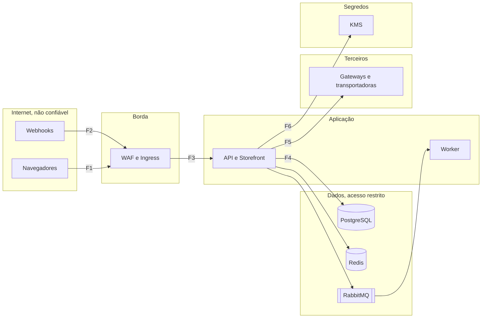

# Modelo de ameaças

Método: STRIDE aplicado às fronteiras de confiança. Este documento será revisado a cada fase e sempre que surgir uma integração nova.

## 1. Ativos

| Ativo | Impacto se comprometido |
| --- | --- |
| Dados de clientes de cada loja | Crítico: incidente LGPD e perda de confiança |
| Credenciais de gateways por tenant | Crítico: fraude financeira |
| Contas de Super Admin | Crítico: acesso a todas as lojas |
| Integridade de pedidos e pagamentos | Crítico: prejuízo direto |
| Chaves de assinatura e chave mestra | Crítico: falsificação de sessões e leitura de segredos |
| Disponibilidade da plataforma | Alto: todas as lojas param juntas |

## 2. Fronteiras de confiança

## 3. Ameaças e mitigações

| ID | STRIDE | Ameaça | Mitigação | Teste na fase |
| --- | --- | --- | --- | --- |
| T01 | Elevação | Tenant A lê dados do tenant B alterando um ID (BOLA) | RLS, filtro no repositório, autorização por recurso | 3 |
| T02 | Falsificação | Cabeçalho `Host` forjado para assumir outra loja | Somente hosts verificados; proxies confiáveis | 3 |
| T03 | Falsificação | Token de uma loja reutilizado em outra | Comparação de `tid` e `aud` com o tenant da requisição | 4 |
| T04 | Falsificação | Sequestro de domínio abandonado | Verificação DNS e remoção imediata do vínculo | 3 |
| T05 | Falsificação | Credential stuffing e força bruta | Rate limit, atraso progressivo, MFA, alerta | 4 |
| T06 | Falsificação | Roubo de refresh token | Cookie `HttpOnly`, rotação, detecção de reuso | 4 |
| T07 | Violação | Alterar preço ou desconto no navegador | Recálculo total no servidor | 5 |
| T08 | Violação | Webhook de pagamento falsificado | Assinatura com o segredo do tenant e janela de tempo | 6 |
| T09 | Repúdio | Admin nega ter feito uma alteração | Auditoria somente inclusão, com ator, IP e trace | 4 |
| T10 | Divulgação | XSS em conteúdo do CMS rouba dados | Sanitização no servidor, CSP com nonce, Vue sem `v-html` livre | 7 |
| T11 | Divulgação | Script de tenant captura dados de cartão | Campos hospedados e sem scripts de terceiros no pagamento | 6 |
| T12 | Divulgação | Segredos ou dados pessoais em logs | Redação por lista de permissão e teste automatizado | 2 |
| T13 | Divulgação | SSRF por URL de imagem ou webhook | Bloqueio de IPs internos, lista de destinos, sem redirecionamentos | 5 |
| T14 | Divulgação | Cache servindo a página de outra loja | Host na chave da CDN; sem cache de páginas autenticadas | 5 |
| T15 | Negação | Uma loja consome todos os recursos | Rate limit, cotas, timeouts, limite de concorrência | 4 |
| T16 | Negação | Hash de senha usado para esgotar CPU | Limite de hashes simultâneos e rate limit | 4 |
| T17 | Negação | Reservas em massa para esgotar estoque | Limite por sessão, validade curta, detecção de abuso | 5 |
| T18 | Elevação | Staff chega a rota da plataforma | Realm, origem e autorização separados | 4 |
| T19 | Elevação | Mass assignment altera campo protegido | DTOs explícitos por operação | 3 |
| T20 | Violação | Dependência ou imagem comprometida | Versões fixas, scan e SBOM no CI | 2 |
| T21 | Violação | Injeção de CSV em exportações | Escape de fórmulas nas exportações | 5 |
| T22 | Divulgação | Enumeração de contas | Respostas e tempos uniformes no login e na recuperação | 4 |

## 4. Riscos residuais

- Comprometimento de uma conta de Super Admin continua sendo o cenário de maior impacto. Exige MFA forte, acesso temporário, alerta e revisão de auditoria.
- Fraude de pagamento depende também dos controles antifraude do gateway.
- Um ataque volumétrico é mitigado pelo provedor de borda, não pela aplicação.
